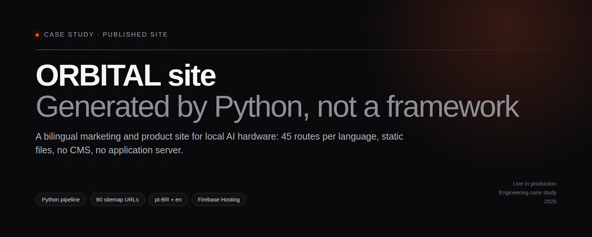
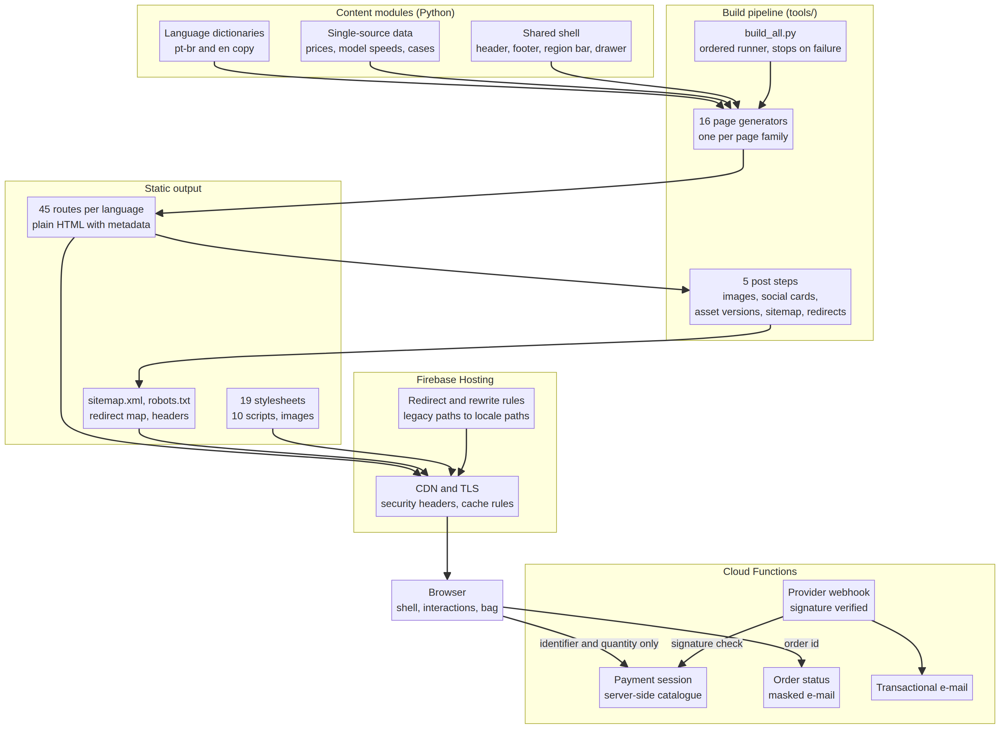
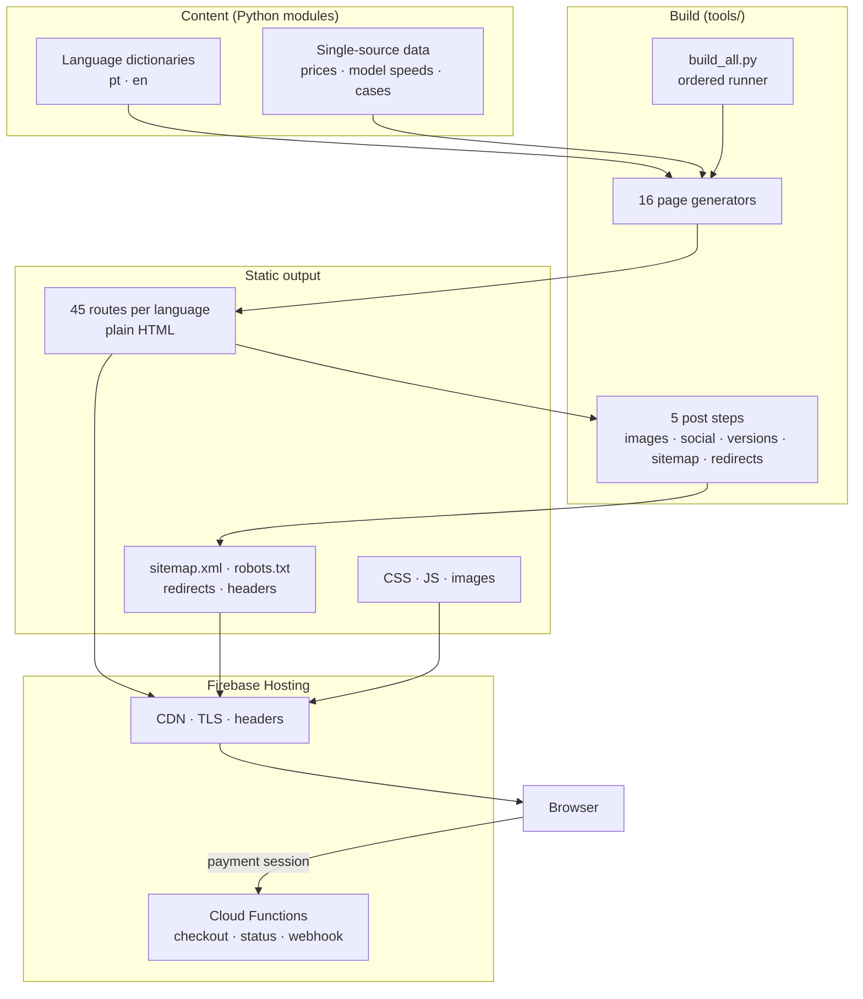
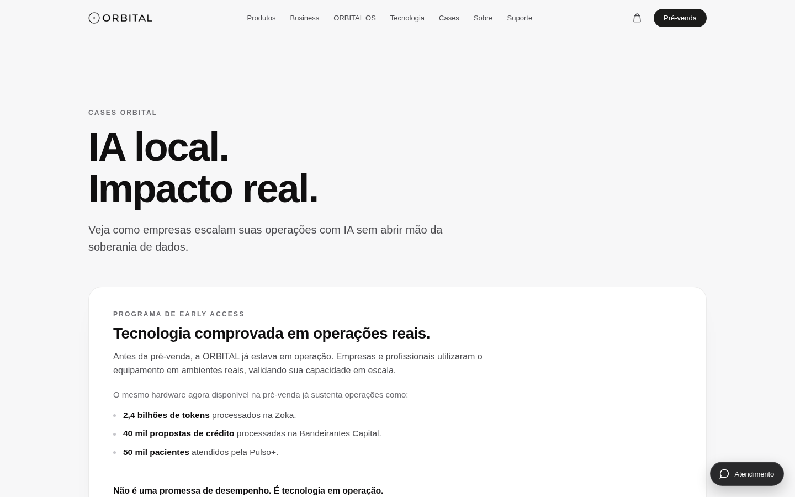

# ORBITAL site
[English](README.md) · [Português](README.pt-BR.md)

A bilingual marketing and product site for local AI hardware, built with hand-written HTML, CSS and JavaScript, and a Python pipeline where a framework would normally sit.



> **What this repository is.** A technical case study of a real site, published and serving two languages. It documents how the site is generated, localised, priced and shipped. It is **not** the source code, it is **not** open source, and it does **not** contain commercial data, customer information or the payment integration.

---

## Overview

ORBITAL sells machines that run open-weight language models locally. The site has to explain hardware to people who compare spec sheets, and it has to do it in Portuguese for Brazil and in English for everywhere else, with prices in the currency of each audience. It covers the home page, four product lines, the operating system section, a case library, company pages, support, the legal set and a pre-sale checkout. There are 45 routes per language and 90 URLs in the sitemap.

The site is published on Firebase Hosting as plain files. There is no application server for the pages, no database and no CMS. A set of Python scripts in `tools/` reads content dictionaries and writes the HTML, then regenerates the sitemap, the redirects and the asset version stamps. Changing a price, a token-per-second figure or a navigation label means editing one module and running one command.

The commerce path and the support surfaces go through a small set of serverless functions: creating a payment session, reading an order status, receiving the payment provider webhook, sending transactional e-mail and logging analytics events. This repository describes that boundary and its controls, not its code.

## The problem

A hardware brand site looks like a design problem and behaves like a data problem. The same four numbers appear on the home page, on four model pages, in a comparison table, inside a structured data block and in the drawer that starts a purchase. The same product has a price in two currencies, and the price has to be consistent with the offer markup that search engines read. The same paragraph of approved legal text has to survive a rebuild without being reformatted.

The second problem is language. Portuguese and English are not translations of each other at the routing level: some paths are translated, some are not, and a page that exists in one language but not the other must not produce a broken `hreflang` pair or an orphan sitemap entry. A static site has no request-time logic to fix that, so the pairing has to be correct at build time or it is wrong in production.

The third problem is the absence of a team. One engineer writes the copy, the markup, the generators and the deployment. Whatever the tooling does not enforce, the engineer has to remember, on every one of 45 routes, twice.

The constraints that shaped the build were: no framework and no bundler; no runtime for the pages; the ability to open any page from the file system; and a git history where a content change is readable as a diff.

## What the product does

**Product catalogue.** A products index, four model pages (Qwen, GPT-oss, DeepSeek and the Ultra), a compact-line page and a specification comparison. Each model page carries a hero, a highlight strip, a gallery, a configuration section, box contents and a technical panel. The Ultra page adds a dark hero and a closing band.

**ORBITAL OS.** An operating system section with its own landing page, a how-it-works page, a model hub, requirements, release notes and a security updates page.

**Case library.** An index and one page per case, each with a narrative, metrics, a quotation, an FAQ, a "next case" link and two cross-links chosen by shared problem rather than by industry.

**Trust and legal.** About, business, careers, press, contact, support, help centre, guides, warranty, trade-in, privacy, acceptable use and pre-sale terms, in both languages, with the legal text reproduced as approved.

**Commerce path.** A local bag, a pre-sale checkout page with address lookup, a payment session created server side, an order status page and a confirmation page. Prices come from the server catalogue, never from the browser.

## Architecture




| Component | Responsibility |
|---|---|
| Language dictionaries | All visible copy, per locale, in `TXT["pt"]` and `TXT["en"]` |
| Single-source data modules | Prices, currency, model speeds, case entries, currency conversion |
| `build_all.py` | Runs every generator in a fixed order, stops on the first failure |
| Page generators | One per page family, each importing the shared shell |
| Post steps | Image localisation, social cards, asset versioning, sitemap, redirects |
| Static output | HTML, CSS, JavaScript and images, served as files |
| Hosting layer | TLS, CDN, security headers, redirect rules, cache policy |
| Cloud Functions | Payment session, order status, webhook, transactional e-mail, analytics |

A build run starts with a content edit and ends with deployable files. `build_all.py` calls each generator as a subprocess, in order, and aborts on a non-zero exit code. Each generator writes its pages into the language trees. Then the post steps run: interface images are swapped for their English variants, social cards are added where a page lacks them, every CSS and JavaScript reference gets a content hash, the sitemap is rebuilt from the files that actually exist, and the redirect map is regenerated. The output directory is then published to hosting, which serves it from the edge with the header rules in its configuration.

## Engineering highlights

### A build pipeline that replaces a CMS

The first version of this site was hand-edited HTML, one file per page and language. Every structural change, a new navigation item, a new footer column, a new section on all model pages, meant the same edit repeated dozens of times, and the copies drifted. The replacement is a Python function per page family that takes a content dictionary and returns a string of HTML. Thirteen of the sixteen generators import the same shell module, which owns the header, the footer, the region bar and the purchase drawer, so those exist once.

The cost is that HTML is now assembled by string concatenation. Nothing validates the markup before it ships, so a missing closing tag is a visual bug found in the browser, not a build error. The pipeline is also linear and unconditional: every run rewrites every page, which makes diffs large and offers no incremental build. The gain is that structural change is one edit in one file, and the diff proves it.

### Two languages, one set of routes

Language pairing is the part that a static site cannot fix after the fact. Each page declares a canonical URL equal to its real file path, plus three alternates: `pt-BR`, `en` and `x-default`, which points at the English page. The sitemap is not a hand-kept list. It is generated by walking the published tree for `index.html` files, skipping anything marked `noindex` and skipping the archived folder, then pairing pages by path identity.

Two details make that work. Pages whose slug differs between languages (`obrigado` and `thank-you`) are reconciled through an explicit alias map, because path identity alone would leave them unpaired. And the modification date comes from the page's own structured data when present, otherwise from git: if the working copy differs from the last commit the page is dated today, if it is identical it inherits the commit date.

The trade-off is order dependency. The sitemap is only correct because it runs last, after every generator; a page that is generated but not registered in the pipeline is silently absent from it.

### Prices computed, not typed

Every monetary figure in the case pages is derived. The value is stored once as an integer in the operating currency, and the English page shows the converted amount, formatted for the locale: dot as thousands separator in Portuguese, comma in English. The exchange rate is a constant in a single module, not an API call, because a static page cannot show a number that changes between two visits.

Rounding is banded and the step is chosen on the converted value, so results read as round figures rather than spreadsheet output. Payback is arithmetic too: equipment price in the page's currency divided by the monthly saving, rounded to months. The same case can therefore show a different payback in each language, because each closes the calculation in its own currency.

The trade-off is that the rate decays. It is a liability with a review threshold rather than a fact, and two languages of the same case can disagree, which a reader who switches language will notice.

### The image fallback contract

Product renders arrive late, and a marketing page cannot ship with an empty hero. Each hero targets an `` element by id, and the parallax script moves that element. When the render is missing, an inline error handler reveals a CSS-drawn chassis in its place. A small observer mirrors the transform from the image to the chassis, so the motion keeps working without changing the main script.

That contract is written down as a rule that cannot be broken: the ids live on the ``, not on a wrapper, and the chassis is the image's previous sibling. Explicit `width` and `height` on every image reserve the space; the hero loads eagerly and the gallery lazily.

The cost is a second representation of the product in CSS that has to be maintained, and markup that cannot be reorganised without re-reading the fallback. When the real renders land, both paths stay.

## Tech stack

| Layer | Choice | Why |
|---|---|---|
| Markup and styling | Hand-written HTML and CSS | No build step, no framework upgrade path, opens from the file system |
| Behaviour | Vanilla JavaScript, one file per concern | No transpiler and no hydration step; readable without tooling |
| Generation | Python 3 standard library | String templates and dictionaries were enough; no dependency to pin |
| Content | Python modules and dictionaries | Content changes are reviewed as code diffs |
| Hosting | Firebase Hosting | Static delivery, header rules and redirects in one config file |
| Server logic | Cloud Functions (Node) | Only the operations that need a secret or a signature |
| Payments | Hosted checkout session | Card data never touches the site |
| Analytics | Tag manager plus GA4, consent gated | Marketing needs events, not identifiers |
| E-mail | Transactional API | Order confirmation without an application server |

## By the numbers

| Metric | Value |
|---|---|
| Tracked files | 417 |
| Lines of tracked text | ~74,000, mostly generated HTML |
| Commits | 231 |
| Python scripts in `tools/` | 37 |
| Steps run by `build_all.py` | 21 (16 page generators, 5 post-processing) |
| Page types | 20+ |
| Routes per language | 45 |
| Sitemap URLs | 90 |
| Case pages | 11 (eight at first publication) |
| Stylesheets | 19 |
| JavaScript files | 10 (2,782 lines) |
| Installed runtime dependencies | 0 |
| Function test files | 5 |

## Screenshots

Five surfaces of the published site, captured at 1440 pixels wide in November 2026.

The home page, where the product line is introduced before any specification:


A product line page, with the specification table that the generator builds from the same data used in the comparison:


The operating system section and the case library:




A case page, which is the surface that most often breaks a static build when a heading, a caption or a language variant is missing:


## Security and privacy

Implemented: a static surface with no secrets in any served file; a content security policy that allows only the site's own origin plus the analytics and function endpoints it needs; `X-Frame-Options`, `Permissions-Policy`, `Referrer-Policy`, HSTS and `nosniff` on every response; an explicit publish ignore list so tooling, documentation, functions and repository metadata are not served; `noindex` on archived routes; analytics consent denied by default and updated only after an explicit choice; server-side catalogue lookups so the browser sends a product identifier and a quantity, never a price; webhook signature verification over the raw body; masked customer e-mail on the order status page; per-instance rate limiting and a request size cap on the payment function.

Not claimed: the rate limit is per instance and does not stop a distributed source, there is no WAF in front of the functions, there is no uptime or error alerting, and this repository asserts no certification or legal compliance. The content security policy still allows inline scripts, which weakens it against injection; the reason and the alternative are in [docs/SECURITY.md](docs/SECURITY.md).

## Scope of this repository

Published: the architecture, seven decision records, a case study of the build, the security model, two diagrams and three self-contained examples that illustrate the techniques with generic names and fictional data.

Omitted on purpose: the product source code, the content dictionaries and the copy itself, the price and speed values, the payment provider integration, the functions code, the internal documentation, the shipping panel, order and customer data, the analytics configuration, the hosting project identifiers and the git history. Where a detail would let someone rebuild the commercial asset, this repository explains the mechanism and stops.

## Repository map

```
.
├── README.md
├── LICENSE
├── .gitignore
├── docs/
│   ├── ARCHITECTURE.md
│   ├── CASE-STUDY.md
│   ├── DECISIONS.md
│   ├── SECURITY.md
│   └── banner.png
├── diagrams/
│   ├── architecture.mmd
│   ├── architecture.png
│   ├── flow.mmd
│   └── flow.png
└── examples/
    ├── README.md
    ├── build_static_pages.py
    ├── currency_rounding.py
    └── hreflang_sitemap.py
```

## Documentation

- [Architecture](docs/ARCHITECTURE.md)
- [Decisions](docs/DECISIONS.md)
- [Case study](docs/CASE-STUDY.md)
- [Security and privacy](docs/SECURITY.md)
- [Português](README.pt-BR.md)

## Author

**Hay Beaumont**, front-end and platform engineer. I build and operate the site end to end: markup, generators, localisation, hosting and the serverless boundary.

[github.com/yahbeaumont](https://github.com/yahbeaumont)
