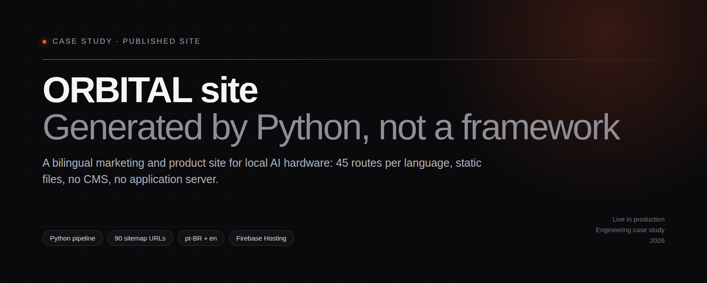
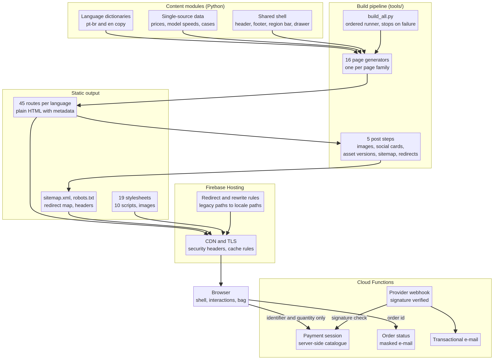
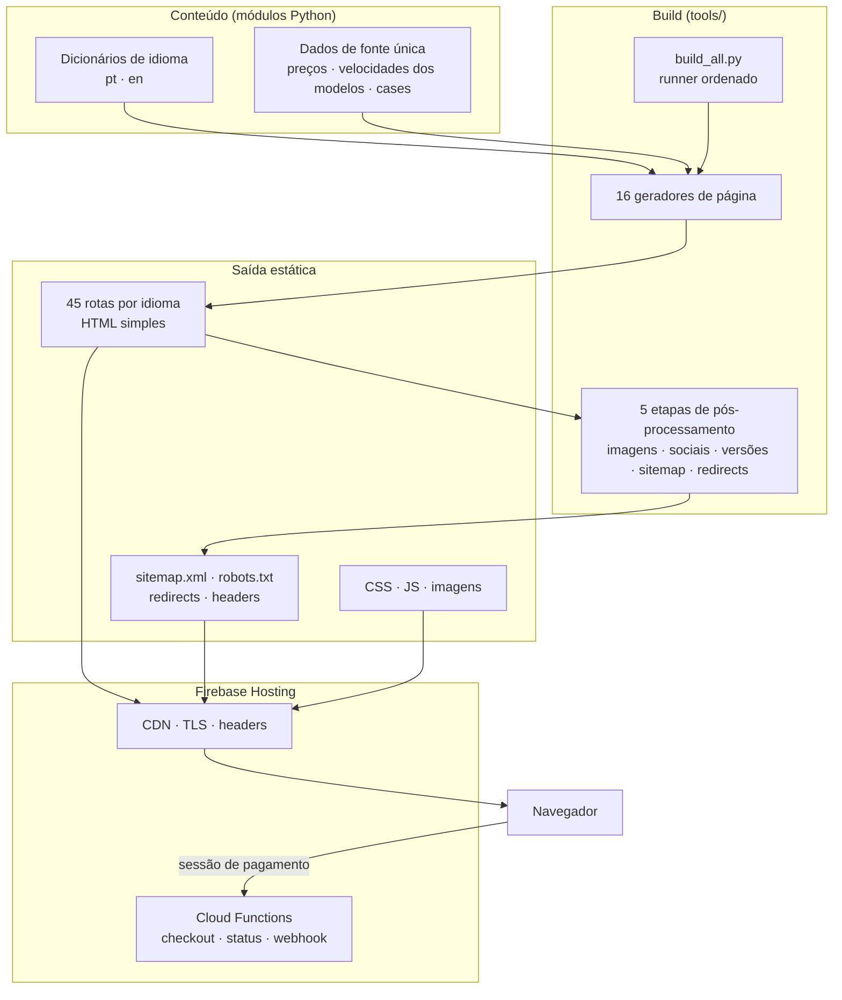
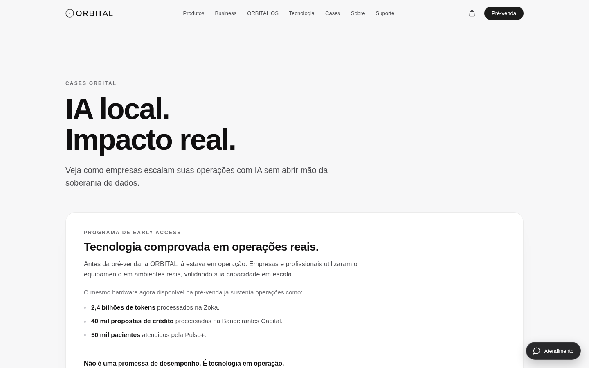

# ORBITAL site
[English](README.md) · **Português**

Um site de marketing e produto bilíngue para hardware de IA local, feito com HTML, CSS e JavaScript escritos à mão, e um pipeline em Python onde normalmente ficaria um framework.



> **O que é este repositório.** Um estudo de caso técnico de um site real, publicado e atendendo em dois idiomas. Ele documenta como o site é gerado, localizado, precificado e entregue. Ele **não** é o código-fonte, **não** é open source e **não** contém dados comerciais, informações de clientes nem a integração de pagamento.

---

## Visão geral

A ORBITAL vende máquinas que rodam modelos de linguagem de pesos abertos localmente. O site precisa explicar hardware para quem compara fichas técnicas, e precisa fazer isso em português para o Brasil e em inglês para todo o resto, com preços na moeda de cada público. Ele cobre a home, quatro linhas de produto, a seção do sistema operacional, uma biblioteca de cases, páginas da empresa, suporte, o conjunto jurídico e um checkout de pré-venda. São 45 rotas por idioma e 90 URLs no sitemap.

O site é publicado no Firebase Hosting como arquivos simples. Não há servidor de aplicação para as páginas, nem banco de dados, nem CMS. Um conjunto de scripts Python em `tools/` lê dicionários de conteúdo e escreve o HTML, depois regenera o sitemap, os redirects e as marcas de versão dos assets. Mudar um preço, um número de tokens por segundo ou um rótulo de navegação significa editar um módulo e rodar um comando.

O caminho de compra e as superfícies de suporte passam por um pequeno conjunto de funções serverless: criar uma sessão de pagamento, ler o status de um pedido, receber o webhook do provedor de pagamento, enviar e-mail transacional e registrar eventos de analytics. Este repositório descreve essa fronteira e os seus controles, não o código dela.

## O problema

Um site de marca de hardware parece um problema de design e se comporta como um problema de dados. Os mesmos quatro números aparecem na home, em quatro páginas de modelo, numa tabela de comparação, dentro de um bloco de dados estruturados e na gaveta que inicia a compra. O mesmo produto tem um preço em duas moedas, e o preço precisa ser consistente com a marcação de oferta que os buscadores leem. O mesmo parágrafo de texto jurídico aprovado precisa sobreviver a um rebuild sem ser reformatado.

O segundo problema é o idioma. Português e inglês não são traduções um do outro no nível do roteamento: alguns caminhos são traduzidos, outros não, e uma página que existe em um idioma mas não no outro não pode gerar um par `hreflang` quebrado nem uma entrada órfã no sitemap. Um site estático não tem lógica em tempo de requisição para corrigir isso, então o pareamento precisa estar certo em tempo de build, ou está errado em produção.

O terceiro problema é a ausência de time. Um engenheiro escreve o texto, a marcação, os geradores e o deploy. Tudo que o ferramental não impõe, o engenheiro precisa lembrar, em cada uma das 45 rotas, duas vezes.

As restrições que moldaram o build foram: nenhum framework e nenhum bundler; nenhum runtime para as páginas; a possibilidade de abrir qualquer página pelo sistema de arquivos; e um histórico git em que uma mudança de conteúdo é legível como diff.

## O que o produto faz

**Catálogo de produtos.** Um índice de produtos, quatro páginas de modelo (Qwen, GPT-oss, DeepSeek e a Ultra), uma página da linha compacta e uma comparação de especificações. Cada página de modelo traz um hero, uma faixa de destaques, uma galeria, uma seção de configuração, o conteúdo da caixa e um painel técnico. A página da Ultra acrescenta um hero escuro e uma faixa de fechamento.

**ORBITAL OS.** Uma seção de sistema operacional com landing page própria, uma página de como funciona, um hub de modelos, requisitos, notas de versão e uma página de atualizações de segurança.

**Biblioteca de cases.** Um índice e uma página por case, cada uma com uma narrativa, métricas, uma citação, um FAQ, um link de "próximo case" e dois cross-links escolhidos pelo problema em comum, não pelo setor.

**Confiança e jurídico.** Sobre, empresa, carreiras, imprensa, contato, suporte, central de ajuda, guias, garantia, troca, privacidade, uso aceitável e termos de pré-venda, nos dois idiomas, com o texto jurídico reproduzido conforme aprovado.

**Caminho de compra.** Uma sacola local, uma página de checkout de pré-venda com busca de endereço, uma sessão de pagamento criada no servidor, uma página de status do pedido e uma página de confirmação. Os preços vêm do catálogo do servidor, nunca do navegador.

## Arquitetura




| Componente | Responsabilidade |
|---|---|
| Dicionários de idioma | Todo o texto visível, por locale, em `TXT["pt"]` e `TXT["en"]` |
| Módulos de dados de fonte única | Preços, moeda, velocidades dos modelos, entradas de case, conversão de moeda |
| `build_all.py` | Roda todos os geradores em ordem fixa, para na primeira falha |
| Geradores de página | Um por família de página, cada um importando o shell compartilhado |
| Etapas de pós-processamento | Localização de imagens, cards sociais, versionamento de assets, sitemap, redirects |
| Saída estática | HTML, CSS, JavaScript e imagens, servidos como arquivos |
| Camada de hospedagem | TLS, CDN, headers de segurança, regras de redirect, política de cache |
| Cloud Functions | Sessão de pagamento, status do pedido, webhook, e-mail transacional, analytics |

Uma execução de build começa com uma edição de conteúdo e termina com arquivos prontos para deploy. O `build_all.py` chama cada gerador como subprocesso, em ordem, e aborta em um código de saída diferente de zero. Cada gerador escreve as suas páginas nas árvores de idioma. Depois rodam as etapas de pós-processamento: as imagens de interface são trocadas pelas variantes em inglês, cards sociais são adicionados onde a página não tem, toda referência de CSS e JavaScript recebe um hash de conteúdo, o sitemap é reconstruído a partir dos arquivos que realmente existem e o mapa de redirects é regenerado. O diretório de saída é então publicado na hospedagem, que o serve da borda com as regras de header da sua configuração.

## Destaques de engenharia

### Um pipeline de build que substitui um CMS

A primeira versão deste site era HTML editado à mão, um arquivo por página e idioma. Toda mudança estrutural, um novo item de navegação, uma nova coluna no rodapé, uma nova seção em todas as páginas de modelo, significava a mesma edição repetida dezenas de vezes, e as cópias iam divergindo. A substituição é uma função Python por família de página que recebe um dicionário de conteúdo e devolve uma string de HTML. Treze dos dezesseis geradores importam o mesmo módulo de shell, que é dono do header, do rodapé, da barra de região e da gaveta de compra, então esses elementos existem uma vez só.

O custo é que o HTML agora é montado por concatenação de strings. Nada valida a marcação antes de ela ir para o ar, então uma tag de fechamento faltando é um bug visual encontrado no navegador, não um erro de build. O pipeline também é linear e incondicional: cada execução reescreve todas as páginas, o que deixa os diffs grandes e não oferece build incremental. O ganho é que mudança estrutural é uma edição em um arquivo, e o diff prova isso.

### Dois idiomas, um conjunto de rotas

O pareamento de idiomas é a parte que um site estático não consegue corrigir depois do fato. Cada página declara uma URL canônica igual ao seu caminho real de arquivo, mais três alternates: `pt-BR`, `en` e `x-default`, que aponta para a página em inglês. O sitemap não é uma lista mantida à mão. Ele é gerado percorrendo a árvore publicada em busca de arquivos `index.html`, pulando tudo que está marcado como `noindex` e pulando a pasta arquivada, e então pareando as páginas pela identidade do caminho.

Dois detalhes fazem isso funcionar. Páginas cujo slug difere entre os idiomas (`obrigado` e `thank-you`) são reconciliadas por um mapa de alias explícito, porque só a identidade de caminho as deixaria sem par. E a data de modificação vem dos dados estruturados da própria página quando existem, senão vem do git: se a cópia de trabalho difere do último commit, a página é datada de hoje; se é idêntica, herda a data do commit.

O trade-off é a dependência de ordem. O sitemap só está correto porque roda por último, depois de todos os geradores; uma página que é gerada mas não está registrada no pipeline fica silenciosamente ausente dele.

### Preços calculados, não digitados

Todo valor monetário nas páginas de case é derivado. O valor é guardado uma vez como inteiro na moeda de operação, e a página em inglês mostra o montante convertido, formatado para o locale: ponto como separador de milhar em português, vírgula em inglês. A taxa de câmbio é uma constante em um único módulo, não uma chamada de API, porque uma página estática não pode mostrar um número que muda entre duas visitas.

O arredondamento é por faixas e o passo é escolhido sobre o valor convertido, então os resultados leem como números redondos em vez de saída de planilha. O payback também é aritmética: preço do equipamento na moeda da página dividido pela economia mensal, arredondado em meses. O mesmo case pode, portanto, mostrar um payback diferente em cada idioma, porque cada um fecha o cálculo na sua própria moeda.

O trade-off é que a taxa se deteriora. Ela é um passivo com um limiar de revisão, não um fato, e os dois idiomas do mesmo case podem discordar, o que um leitor que troca de idioma vai notar.

### O contrato de fallback da imagem

Os renders de produto chegam tarde, e uma página de marketing não pode ir para o ar com um hero vazio. Cada hero mira um elemento `` por id, e o script de parallax move esse elemento. Quando o render está faltando, um handler de erro inline revela um chassi desenhado em CSS no lugar dele. Um observer pequeno espelha o transform da imagem para o chassi, então o movimento continua funcionando sem alterar o script principal.

Esse contrato está escrito como uma regra que não pode ser quebrada: os ids ficam no ``, não em um wrapper, e o chassi é o irmão anterior da imagem. `width` e `height` explícitos em toda imagem reservam o espaço; o hero carrega de forma eager e a galeria de forma lazy.

O custo é uma segunda representação do produto em CSS que precisa ser mantida, e uma marcação que não pode ser reorganizada sem reler o fallback. Quando os renders reais chegam, os dois caminhos permanecem.

## Stack de tecnologia

| Camada | Escolha | Por quê |
|---|---|---|
| Marcação e estilos | HTML e CSS escritos à mão | Sem etapa de build, sem caminho de upgrade de framework, abre pelo sistema de arquivos |
| Comportamento | JavaScript vanilla, um arquivo por responsabilidade | Sem transpilador e sem etapa de hidratação; legível sem ferramentas |
| Geração | Biblioteca padrão do Python 3 | Templates de string e dicionários bastaram; nenhuma dependência para fixar |
| Conteúdo | Módulos e dicionários Python | Mudanças de conteúdo são revisadas como diffs de código |
| Hospedagem | Firebase Hosting | Entrega estática, regras de header e redirects em um único arquivo de configuração |
| Lógica de servidor | Cloud Functions (Node) | Apenas as operações que precisam de um segredo ou de uma assinatura |
| Pagamentos | Sessão de checkout hospedada | Dados de cartão nunca passam pelo site |
| Analytics | Tag manager mais GA4, condicionado a consentimento | Marketing precisa de eventos, não de identificadores |
| E-mail | API transacional | Confirmação de pedido sem servidor de aplicação |

## Em números

| Métrica | Valor |
|---|---|
| Arquivos rastreados | 417 |
| Linhas de texto rastreadas | ~74,000, em boa parte HTML gerado |
| Commits | 231 |
| Scripts Python em `tools/` | 37 |
| Etapas rodadas pelo `build_all.py` | 21 (16 geradores de página, 5 de pós-processamento) |
| Tipos de página | 20+ |
| Rotas por idioma | 45 |
| URLs no sitemap | 90 |
| Páginas de case | 11 (oito na primeira publicação) |
| Folhas de estilo | 19 |
| Arquivos JavaScript | 10 (2,782 linhas) |
| Dependências de runtime instaladas | 0 |
| Arquivos de teste das functions | 5 |

## Capturas de tela

Cinco superfícies do site publicado, capturadas com 1440 pixels de largura em novembro de 2026.

A home, onde a linha de produto é apresentada antes de qualquer especificação:


Uma página de linha de produto, com a tabela de especificações que o gerador monta a partir dos mesmos dados usados na comparação:


A seção do sistema operacional e a biblioteca de cases:




Uma página de case, que é a superfície que mais quebra um build estático quando falta um título, uma legenda ou uma variante de idioma:


## Segurança e privacidade

Implementado: uma superfície estática sem segredos em nenhum arquivo servido; uma política de segurança de conteúdo que permite apenas a origem do próprio site mais os endpoints de analytics e de functions de que ele precisa; `X-Frame-Options`, `Permissions-Policy`, `Referrer-Policy`, HSTS e `nosniff` em toda resposta; uma lista explícita de ignore na publicação, para que ferramental, documentação, functions e metadados do repositório não sejam servidos; `noindex` nas rotas arquivadas; consentimento de analytics negado por padrão e atualizado apenas depois de uma escolha explícita; consultas de catálogo no servidor, para que o navegador envie um identificador de produto e uma quantidade, nunca um preço; verificação de assinatura do webhook sobre o corpo bruto; e-mail do cliente mascarado na página de status do pedido; rate limiting por instância e limite de tamanho de requisição na função de pagamento.

Não afirmado: o rate limit é por instância e não barra uma origem distribuída, não há WAF na frente das functions, não há alerta de disponibilidade nem de erro, e este repositório não afirma certificação nem conformidade legal. A política de segurança de conteúdo ainda permite scripts inline, o que a enfraquece contra injeção; o motivo e a alternativa estão em [docs/pt-BR/SEGURANCA.md](docs/pt-BR/SEGURANCA.md).

## Escopo deste repositório

Publicado: a arquitetura, sete registros de decisão, um estudo de caso do build, o modelo de segurança, dois diagramas e três exemplos autocontidos que ilustram as técnicas com nomes genéricos e dados fictícios.

Omitido de propósito: o código-fonte do produto, os dicionários de conteúdo e o texto em si, os valores de preço e de velocidade, a integração com o provedor de pagamento, o código das functions, a documentação interna, o painel de expedição, dados de pedidos e de clientes, a configuração de analytics, os identificadores do projeto de hospedagem e o histórico git. Onde um detalhe permitiria a alguém reconstruir o ativo comercial, este repositório explica o mecanismo e para.

## Mapa do repositório

```
.
├── README.md
├── LICENSE
├── .gitignore
├── docs/
│   ├── ARCHITECTURE.md
│   ├── CASE-STUDY.md
│   ├── DECISIONS.md
│   ├── SECURITY.md
│   └── banner.png
├── diagrams/
│   ├── architecture.mmd
│   ├── architecture.png
│   ├── flow.mmd
│   └── flow.png
└── examples/
    ├── README.md
    ├── build_static_pages.py
    ├── currency_rounding.py
    └── hreflang_sitemap.py
```

## Documentação

- [Arquitetura](docs/pt-BR/ARQUITETURA.md)
- [Decisões](docs/pt-BR/DECISOES.md)
- [Estudo de caso](docs/pt-BR/ESTUDO-DE-CASO.md)
- [Segurança e privacidade](docs/pt-BR/SEGURANCA.md)
- [English](README.md)

## Autor

**Hay Beaumont**, engenheiro front-end e de plataforma. Eu construo e opero o site de ponta a ponta: marcação, geradores, localização, hospedagem e a fronteira serverless.

[github.com/yahbeaumont](https://github.com/yahbeaumont)
