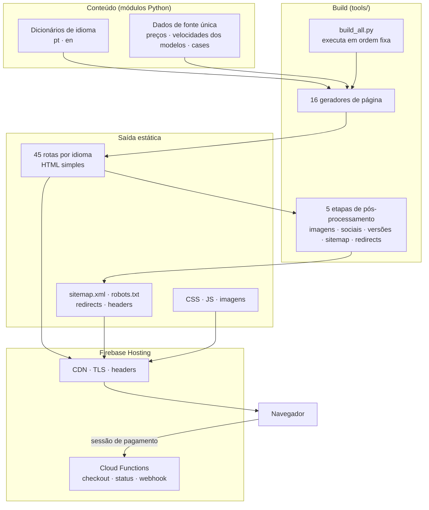

# ORBITAL site
[English](README.md) · **Português**

Site de marketing e de produto, bilíngue, para hardware de IA local. O HTML, o CSS e o JavaScript são escritos à mão; onde normalmente haveria um framework, existe um pipeline em Python.


> **O que é este repositório.** Um estudo de caso técnico de um site real, no ar e atendendo em dois idiomas. Aqui está documentado como o site é gerado, localizado, precificado e publicado. O repositório **não** traz o código-fonte, **não** é open source e **não** contém dados comerciais, informações de clientes nem a integração de pagamento.

---

## Visão geral

A ORBITAL vende máquinas que rodam modelos de linguagem de pesos abertos localmente. O site precisa explicar hardware para quem compara ficha técnica, e fazer isso em português para o Brasil e em inglês para o resto do mundo, com preço na moeda de cada público. A cobertura inclui a home, quatro linhas de produto, a seção do sistema operacional, a biblioteca de cases, as páginas da empresa, o suporte, o conjunto jurídico e um checkout de pré-venda. São 45 rotas por idioma e 90 URLs no sitemap.

O site vai para o Firebase Hosting como arquivos simples. Não existe servidor de aplicação para as páginas, nem banco de dados, nem CMS. Scripts Python em `tools/` leem dicionários de conteúdo, escrevem o HTML e em seguida regeram o sitemap, os redirects e as marcas de versão dos assets. Para mudar um preço, um número de tokens por segundo ou um rótulo de navegação, basta editar um módulo e rodar um comando.

O caminho de compra e as superfícies de suporte passam por um punhado de funções serverless: criar sessão de pagamento, ler o status de um pedido, receber o webhook do provedor de pagamento, enviar e-mail transacional e registrar eventos de analytics. Este repositório descreve essa fronteira e os controles que ela tem. O código dela fica de fora.

## O problema

Um site de marca de hardware parece um problema de design, mas se comporta como um problema de dados. Os mesmos quatro números aparecem na home, em quatro páginas de modelo, numa tabela de comparação, dentro de um bloco de dados estruturados e na gaveta que inicia a compra. O mesmo produto tem preço em duas moedas, e esse preço precisa bater com a marcação de oferta que os buscadores leem. O mesmo parágrafo de texto jurídico aprovado também precisa atravessar um rebuild sem ser reformatado.

O segundo problema é o idioma. No nível do roteamento, português e inglês não são traduções um do outro: alguns caminhos são traduzidos, outros não. Uma página que só existe em um dos idiomas não pode gerar par `hreflang` quebrado nem entrada órfã no sitemap. Site estático não tem lógica em tempo de requisição para consertar isso depois, então o pareamento ou está certo em tempo de build, ou está errado em produção.

O terceiro problema é a falta de time. Um engenheiro só escreve o texto, a marcação, os geradores e faz o deploy. Tudo o que o ferramental não impõe sobra para a memória dele, em cada uma das 45 rotas, duas vezes.

As restrições que moldaram o build: nada de framework e nada de bundler; nenhum runtime para as páginas; qualquer página abre direto do sistema de arquivos; e um histórico git em que uma mudança de conteúdo se lê como diff.

## O que o produto faz

**Catálogo de produtos.** Um índice de produtos, quatro páginas de modelo (Qwen, GPT-oss, DeepSeek e a Ultra), uma página da linha compacta e uma comparação de especificações. Cada página de modelo traz hero, faixa de destaques, galeria, seção de configuração, conteúdo da caixa e painel técnico. A página da Ultra acrescenta um hero escuro e uma faixa de fechamento.

**ORBITAL OS.** Uma seção de sistema operacional com landing page própria, uma página de como funciona, um hub de modelos, requisitos, notas de versão e uma página de atualizações de segurança.

**Biblioteca de cases.** Um índice e uma página por case, cada uma com narrativa, métricas, uma citação, um FAQ, um link de "próximo case" e dois cross-links escolhidos pelo problema em comum, não pelo setor.

**Confiança e jurídico.** Sobre, empresa, carreiras, imprensa, contato, suporte, central de ajuda, guias, garantia, troca, privacidade, uso aceitável e termos de pré-venda, nos dois idiomas, com o texto jurídico reproduzido conforme aprovado.

**Caminho de compra.** Uma sacola local, uma página de checkout de pré-venda com busca de endereço, uma sessão de pagamento criada no servidor, uma página de status do pedido e uma página de confirmação. Os preços vêm do catálogo do servidor, nunca do navegador.

## Arquitetura




| Componente | Responsabilidade |
|---|---|
| Dicionários de idioma | Todo o texto visível, por locale, em `TXT["pt"]` e `TXT["en"]` |
| Módulos de dados de fonte única | Preços, moeda, velocidades dos modelos, entradas de case, conversão de moeda |
| `build_all.py` | Roda todos os geradores em ordem fixa e para na primeira falha |
| Geradores de página | Um por família de página, cada um importando o shell compartilhado |
| Etapas de pós-processamento | Localização de imagens, cards sociais, versionamento de assets, sitemap, redirects |
| Saída estática | HTML, CSS, JavaScript e imagens, servidos como arquivos |
| Camada de hospedagem | TLS, CDN, headers de segurança, regras de redirect, política de cache |
| Cloud Functions | Sessão de pagamento, status do pedido, webhook, e-mail transacional, analytics |

Toda execução de build parte de uma edição de conteúdo e termina em arquivos prontos para deploy. O `build_all.py` chama cada gerador como subprocesso, na ordem definida, e aborta no primeiro código de saída diferente de zero. Cada gerador escreve as suas páginas na árvore do idioma correspondente. Aí entram as etapas de pós-processamento: as imagens de interface são trocadas pelas variantes em inglês, cards sociais entram onde faltam, toda referência de CSS e JavaScript ganha um hash de conteúdo, o sitemap é reconstruído a partir dos arquivos que existem de fato e o mapa de redirects é regerado. O diretório de saída vai então para a hospedagem, que o serve na borda com as regras de header da configuração.

## Destaques de engenharia

### Um pipeline de build no lugar de um CMS

A primeira versão do site era HTML editado à mão, um arquivo por página e por idioma. Qualquer mudança estrutural, como um item novo de navegação, uma coluna nova no rodapé ou uma seção nova em todas as páginas de modelo, exigia a mesma edição repetida dezenas de vezes. As cópias iam divergindo. A solução foi uma função Python por família de página: recebe um dicionário de conteúdo, devolve uma string de HTML. Treze dos dezesseis geradores importam o mesmo módulo de shell, dono do header, do rodapé, da barra de região e da gaveta de compra. Esses elementos existem uma vez só.

O preço disso é que o HTML passou a ser montado por concatenação de strings. Nada valida a marcação antes de ela ir para o ar, então uma tag de fechamento ausente é bug visual descoberto no navegador, não erro de build. O pipeline também é linear e incondicional: cada execução reescreve todas as páginas, o que infla os diffs e não oferece build incremental. Em troca, mudança estrutural virou uma edição em um arquivo, e o diff mostra isso.

### Dois idiomas, um conjunto de rotas

O pareamento de idiomas é justamente a parte que um site estático não consegue consertar depois. Cada página declara uma URL canônica igual ao caminho real do arquivo, mais três alternates: `pt-BR`, `en` e `x-default`, que aponta para a página em inglês. O sitemap não é uma lista mantida à mão. Ele nasce de uma varredura da árvore publicada atrás de arquivos `index.html`: fica de fora o que está marcado como `noindex` e a pasta arquivada; o resto é pareado pela identidade do caminho.

Dois detalhes fazem a coisa funcionar. Páginas com slug diferente entre os idiomas (`obrigado` e `thank-you`) passam por um mapa de alias explícito, porque só a identidade de caminho as deixaria sem par. Já a data de modificação vem dos dados estruturados da própria página, quando existem. Se não existem, vem do git: quando a cópia de trabalho difere do último commit, a página leva a data de hoje; quando é idêntica, herda a data do commit.

O trade-off é a dependência de ordem. O sitemap só está certo porque roda por último, depois de todos os geradores. Uma página que o pipeline gera mas não registra fica fora dele sem aviso.

### Preços calculados, não digitados

Todo valor monetário nas páginas de case é derivado. O valor fica guardado uma única vez, como inteiro, na moeda de operação. A página em inglês mostra o montante convertido, formatado para o locale: ponto como separador de milhar em português, vírgula em inglês. A taxa de câmbio é uma constante em um módulo só, não uma chamada de API. Página estática não pode exibir um número que muda entre duas visitas.

O arredondamento trabalha por faixas e o passo sai do valor convertido, então o resultado lê como número redondo, não como saída de planilha. O payback é aritmética também: preço do equipamento na moeda da página dividido pela economia mensal, arredondado em meses. Por isso o mesmo case pode mostrar payback diferente em cada idioma: cada página fecha a conta na moeda dela.

O trade-off é que a taxa envelhece. Ela é um passivo com limiar de revisão, não um fato, e os dois idiomas do mesmo case podem discordar num número derivado. Quem troca de idioma percebe.

### O contrato de fallback da imagem

Render de produto chega tarde, e página de marketing não pode ir para o ar com hero vazio. Cada hero aponta para um `` por id, e é esse elemento que o script de parallax move. Quando o render falta, um handler de erro inline revela no lugar dele um chassi desenhado em CSS. Um observer pequeno espelha o transform da imagem no chassi, e o movimento continua sem que o script principal mude.

O contrato está escrito como regra que não se quebra: os ids ficam no ``, nunca num wrapper, e o chassi é o irmão anterior da imagem. `width` e `height` explícitos em toda imagem reservam o espaço; o hero carrega eager, a galeria lazy.

O custo é uma segunda representação do produto, em CSS, que precisa de manutenção, mais uma marcação que não se reorganiza sem reler o fallback. Quando os renders reais chegam, os dois caminhos continuam.

## Stack de tecnologia

| Camada | Escolha | Por quê |
|---|---|---|
| Marcação e estilos | HTML e CSS escritos à mão | Sem etapa de build, sem caminho de upgrade de framework, abre pelo sistema de arquivos |
| Comportamento | JavaScript vanilla, um arquivo por responsabilidade | Sem transpilador e sem etapa de hidratação; legível sem ferramentas |
| Geração | Biblioteca padrão do Python 3 | Templates de string e dicionários bastaram; nenhuma dependência para fixar |
| Conteúdo | Módulos e dicionários Python | Mudança de conteúdo é revisada como diff de código |
| Hospedagem | Firebase Hosting | Entrega estática, regras de header e redirects num único arquivo de configuração |
| Lógica de servidor | Cloud Functions (Node) | Só as operações que precisam de segredo ou de assinatura |
| Pagamentos | Sessão de checkout hospedada | Dado de cartão nunca passa pelo site |
| Analytics | Tag manager e GA4, condicionados a consentimento | Marketing precisa de eventos, não de identificadores |
| E-mail | API transacional | Confirmação de pedido sem servidor de aplicação |

## Em números

| Métrica | Valor |
|---|---|
| Arquivos rastreados | 417 |
| Linhas de texto rastreadas | ~74,000, em boa parte HTML gerado |
| Commits | 231 |
| Scripts Python em `tools/` | 37 |
| Etapas rodadas pelo `build_all.py` | 21 (16 geradores de página, 5 de pós-processamento) |
| Tipos de página | 20+ |
| Rotas por idioma | 45 |
| URLs no sitemap | 90 |
| Páginas de case | 11 (oito na primeira publicação) |
| Folhas de estilo | 19 |
| Arquivos JavaScript | 10 (2,782 linhas) |
| Dependências de runtime instaladas | 0 |
| Arquivos de teste das functions | 5 |

## Capturas de tela

Cinco superfícies do site publicado, capturadas com 1440 pixels de largura em novembro de 2026.

A home, onde a linha de produto aparece antes de qualquer especificação:


Uma página de linha de produto, com a tabela de especificações que o gerador monta a partir dos mesmos dados usados na comparação:


A seção do sistema operacional e a biblioteca de cases:


Uma página de case, a superfície que mais quebra um build estático quando falta um título, uma legenda ou uma variante de idioma:


## Segurança e privacidade

Implementado: superfície estática sem segredo em nenhum arquivo servido; política de segurança de conteúdo que libera apenas a origem do próprio site mais os endpoints de analytics e de functions de que ele precisa; `X-Frame-Options`, `Permissions-Policy`, `Referrer-Policy`, HSTS e `nosniff` em toda resposta; lista explícita de ignore na publicação, para que ferramental, documentação, functions e metadados do repositório fiquem fora do ar; `noindex` nas rotas arquivadas; consentimento de analytics negado por padrão e atualizado só depois de uma escolha explícita; consulta ao catálogo no servidor, para que o navegador envie identificador de produto e quantidade, nunca preço; verificação de assinatura do webhook sobre o corpo bruto; e-mail do cliente mascarado na página de status do pedido; rate limit por instância e limite de tamanho de requisição na função de pagamento.

Não afirmado: o rate limit é por instância e não segura uma origem distribuída; não existe WAF na frente das functions; não há alerta de disponibilidade nem de erro; e este repositório não afirma certificação nem conformidade legal. A política de segurança de conteúdo ainda permite script inline, o que a enfraquece contra injeção. O motivo e a alternativa estão em [docs/pt-BR/SEGURANCA.md](docs/pt-BR/SEGURANCA.md).

## Escopo deste repositório

Publicado: a arquitetura, sete registros de decisão, um estudo de caso do build, o modelo de segurança, dois diagramas e três exemplos autocontidos que ilustram as técnicas com nomes genéricos e dados fictícios.

Omitido de propósito: o código-fonte do produto, os dicionários de conteúdo e o texto em si, os valores de preço e de velocidade, a integração com o provedor de pagamento, o código das functions, a documentação interna, o painel de expedição, dados de pedidos e de clientes, a configuração de analytics, os identificadores do projeto de hospedagem e o histórico git. Onde um detalhe permitiria reconstruir o ativo comercial, o repositório explica o mecanismo e para.

## Mapa do repositório

```
.
├── README.md
├── LICENSE
├── .gitignore
├── docs/
│   ├── ARCHITECTURE.md
│   ├── CASE-STUDY.md
│   ├── DECISIONS.md
│   ├── SECURITY.md
│   └── banner.png
├── diagrams/
│   ├── architecture.mmd
│   ├── architecture.png
│   ├── flow.mmd
│   └── flow.png
└── examples/
    ├── README.md
    ├── build_static_pages.py
    ├── currency_rounding.py
    └── hreflang_sitemap.py
```

## Documentação

- [Arquitetura](docs/pt-BR/ARQUITETURA.md)
- [Decisões](docs/pt-BR/DECISOES.md)
- [Estudo de caso](docs/pt-BR/ESTUDO-DE-CASO.md)
- [Segurança e privacidade](docs/pt-BR/SEGURANCA.md)
- [English](README.md)

## Autor

**Hay Beaumont**, engenheiro front-end e de plataforma. Construo e opero o site de ponta a ponta: marcação, geradores, localização, hospedagem e a fronteira serverless.

[github.com/yahbeaumont](https://github.com/yahbeaumont)
